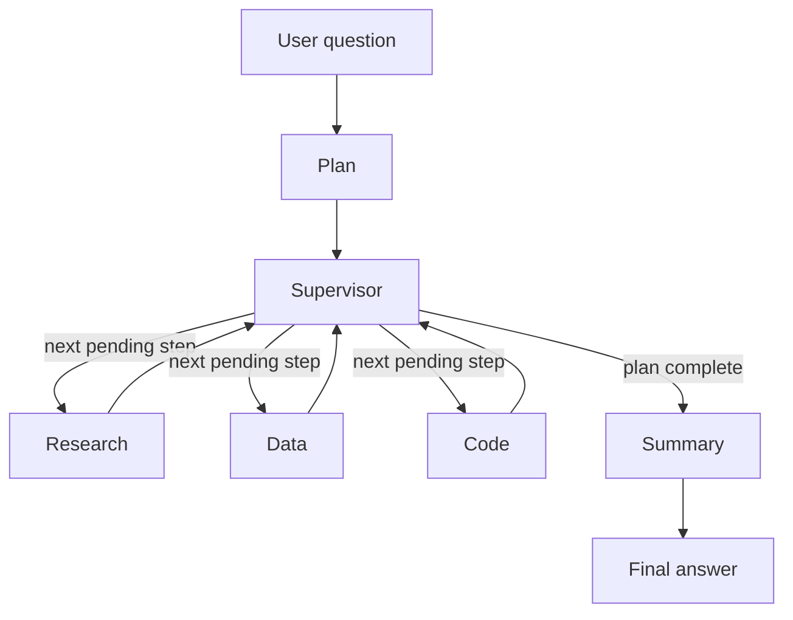

# Architecture

A LangGraph supervisor plans a question, then sends it to Research, Data, and Code. Summary always writes the final answer. The field that chooses the next agent is `next_node`. The supervisor writes it from the next runnable step in `plan`, and the conditional edge reads only that field. The supervisor does not read the question text.

## Corpus snapshot

Questions about Python changes or PEPs accepted after this date are outside the index and are meant for live web search.

| Item | Value |
|---|---|
| Snapshot date | 2026-10-24 |
| Python docs | 3.15 Sphinx text archive, `https://docs.python.org/3/archives/python-3.15-docs-text.zip` |
| Docs included | `library/`, `tutorial/`, `reference/`, `howto/`, `faq/`, `whatsnew/`, and `glossary.txt` |
| PEPs | `python/peps` branch `main`, commit `018ddd7eb73daef5b31ccc557cafdda97bf387ba`, committed 2026-10-24T16:00:19Z |
| PEP source | `https://github.com/python/peps/archive/refs/heads/main.zip` |
| Documents | 1,161 (416 doc pages, 745 PEPs) |
| Chunks | 41,929 |

## Chunking

Each file is split on underlined headings. A section longer than the chunk size is split again with a recursive character splitter: about 1,000 characters, about 200 characters of overlap. Chunks shorter than 120 characters are dropped. Each stored passage starts with a label naming the document and section, so a query can match the title as well as the body.

Chunk ids are stable: `doc_id/section-index-slug/piece`. Re-running `ingest/build_index.py` replaces the collection instead of appending a second copy of the same passage.

## Embedding and storage

| Item | Value |
|---|---|
| Embedding model | `text-embedding-3-small` (1,536 dimensions) |
| Vector store | Chroma persistent collection `corpus` |
| Directory | `./chroma_index` |
| Distance | cosine |
| Metadata | `chunk_id`, `doc_id`, `title`, `section`, `source_url`, `kind` |
| Retrieval k | 5, used by the later Research agent |

Ingest does not run when the server starts. `ingest/download_corpus.py` fetches the archives. `ingest/build_index.py` chunks, embeds, and writes Chroma.

Retrieval is retrieve, then augment, then generate. Research rewrites the question with a low-complexity call, retrieves `k=5` for the rewrite and `k=5` for the original question, and merges the hits. If the question names a PEP, chunks for that PEP are kept even when the rewrite scores higher. The named-PEP lookup reads a wider pool and can add one more passage from that PEP when it contains a question word the first five passages lack. The augmentation prompt is the string Research sends to the generator. It is `RESEARCH_PROMPT` from `app/prompts.py`, then the retrieved passages, then any web results, then the question:

```text
You are the research agent. Answer only from the retrieved passages.
Cite every claim with the chunk id in square brackets, for example [pep-0008/09-imports/0].
If the passages do not support the answer, say that the corpus does not contain it.
The corpus snapshot date is 2026-10-24. Do not invent PEPs accepted after that date.
Do not use outside knowledge to fill gaps in the passages.
When web results are included, name each URL and say whether it answers the question. Cite those claims with the result URL. Do not invent a URL.

Passages:
[{chunk_id}] {title} / {section}
{full chunk text}

Web results:
{web passages, or None.}

Question: {user question}
```

Each block under `Passages:` is one retrieved chunk, and the text is the full chunk rather than a shortened excerpt. Web hits are not repeated in that block. They appear only under `Web results:`.

## PEP table

`ingest/build_sqlite.py` reads the same PEP snapshot and writes `data/peps.sqlite`. The Data agent is the only caller of `tools/sqlite_tool.py`, which accepts one `SELECT` and opens the file read-only.

| Column | Meaning |
|---|---|
| `number` | PEP number, primary key |
| `title` | Header title |
| `status` | Header status, stored as written |
| `type` | Header type |
| `created` | Header created date |
| `python_version` | `Python-Version` header, null when the PEP has none |
| `author` | Header authors, continuation lines joined |

The snapshot has 745 PEPs. 375 of them have status `Final`. That count matches a separate scan of the `Status:` header lines. PEP 8 is status `Active`, not `Final`.

## Code bundle

`code_bundle/pep_tools/` is the source tree the Code agent can open. `tools/code_reader.py` searches it and reads line ranges. A path that leaves the bundle is rejected. The modules check the PEP 8 separate-import rule and format a PEP citation URL.

## Orchestration



The planner calls the cheap model and writes `plan`. The supervisor reads that list and writes `next_node` to the next pending step whose dependencies are `done`. A step whose dependency failed is marked `failed` and skipped. Summary always runs after the planned workers, which sets `next_node` to `summary`. An invalid planner JSON falls back to one research lookup.

## State schema

Defined in `app/state.py` as `AgentState`. `next_node` is the field that chooses the next agent.

| Field | Type | Update | Role |
|---|---|---|---|
| `user_query` | string | replace | The current question |
| `history` | list of `{role, content}` | replace | Prior turns sent by the browser on this request |
| `plan` | list of steps | replace | Ordered work. The supervisor is the only writer after planning |
| `next_node` | string | replace | `research`, `data`, `code`, or `summary`. The conditional edge returns this value |
| `current_step_id` | string | replace | Id of the step just selected |
| `route_log` | list | append | One entry per provider call: agent, provider, model, dimension, reason |
| `agent_outputs` | dict | merge by key | Worker text, keyed by agent |
| `citations` | list | append | Chunk id, title, section, score, excerpt, source URL |
| `errors` | list | append | Recovered failures. The message says the failure was recovered |
| `trace` | list | append | Enter, exit, tool, and route events |
| `final_answer` | string | replace | Summary's answer |

Each plan step has `id`, `agent`, `reason`, `depends_on`, `complexity` (`low` or `high`), `kind`, and `status` (`pending`, `running`, `done`, or `failed`). `depends_on` may name only earlier ids.

## Agents, tools, and prompts

The supervisor is not a specialist and does not call a model. Prompts live in `app/prompts.py`.

| Agent | Tools | Prompt responsibility |
|---|---|---|
| Planner | none | `PLANNER_PROMPT`. Emit one to three JSON steps. Do not schedule Summary. |
| Research | Chroma `retrieve`, `tavily_search` | `RESEARCH_PROMPT`. Answer from retrieved passages and cite chunk ids. Search the web only when the best score is below 0.5 or the question is after the snapshot. |
| Data | `query_database` | `DATA_PROMPT`. Emit one read-only `SELECT` on `peps`, then report the rows. |
| Code | `search_code`, `read_file` | `CODE_PROMPT`. Stay inside `code_bundle/` and cite `path:line`. Read the file that defines the function, and a helper that function calls, instead of stopping at a re-export in `__init__.py`. |
| Summary | `tavily_search`, `tavily_extract` | `SUMMARY_PROMPT`. Merge worker outputs, keep their citations, and name a failed agent. When Research returned a web URL, search that URL, then extract it. |

## LLM routing

`app/routing.py` reads the plan fields `complexity` and `kind`. It does not look at the question text.

| Complexity | Kind | Provider | Model | Dimension |
|---|---|---|---|---|
| low | plan, rewrite, lookup | Google | `gemini-3.8-flash` | cost |
| high | synthesis, summary, code | OpenAI | `gpt-6.1-sol` | capability |

GPT calls go through the Responses API so a later tool call uses the same path. If the chosen provider raises, the step retries once on the other provider. The route log records `fallback: true` and `recovered: true` for that retry. If the retry also fails, the step is marked failed and the caller continues. A saved session is in `eval/route_log.json`.

## Shared Tavily MCP

Research and Summary share one remote MCP server: `https://mcp.tavily.com/mcp/` over Streamable HTTP. `tools/tavily_mcp.py` puts `TAVILY_API_KEY` in the query string. The key is not sent in the request body and is not written into the trace.

Both agents call the same MCP tool, `tavily_search`, with different arguments. Summary then calls `tavily_extract` on the URL Research already returned. Summary does not extract a corpus source URL.

| Agent | Tool | When it runs | Argument |
|---|---|---|---|
| Research | `tavily_search` | The best corpus score is below 0.5, or the question asks about something after the 2026-10-24 snapshot | For a post-snapshot question, `Python PEPs accepted` on `peps.python.org`, `discuss.python.org`, and `blog.python.org`. Otherwise the user question. |
| Summary | `tavily_search` | Research already returned a `tavily-search` citation | `What does this page establish?` plus that citation's URL, limited to the URL's host |
| Summary | `tavily_extract` | The same citation | That citation's URL only |

A saved session is in `eval/phase5_runs.json`.

## Failure handling

Each worker catches an exception, marks that plan step `failed`, and appends an error that names the agent and says the failure was recovered. Control returns to the supervisor. A later step whose dependency failed is skipped and is not executed. Summary still runs and says which part of the answer is missing. `invoke_graph` turns an exception that escapes a node into that same error payload. A saved session is in `eval/phase6_runs.json`.

## Chat API

`main.py` serves `static/` at `/`. The server is stateless. It does not store chat history, and this project does not claim durable multi-turn memory. There is no session database. The browser sends `history` on each `POST /api/chat`, built from the messages already on the page. Refreshing the tab drops that history and starts over.

The response is a Server-Sent Events stream. The handler writes a `: ping` comment before the first model call, then emits `trace`, `route`, `citation`, `token`, and `error` events as the graph runs. `done` closes the stream. `GET /health` returns `ok`, `chroma_count`, and `providers_configured`, and it does not return key values.

The page in `static/` is one HTML file and vanilla JavaScript. The left column is the question box and the streaming transcript. The right column is the live trace. Starter buttons fill the box with the five Phase 3 questions. Tokens append to the current answer, route lines sit under that answer, and a citation chip opens the chunk id, title, section, score, and excerpt. A follow-up sends `history` from the messages already on the page. Refreshing the tab starts over.
