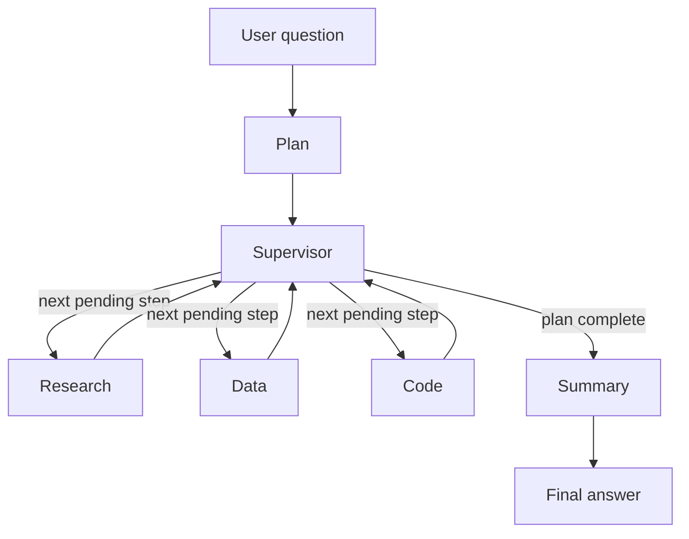

# Architecture

The orchestration diagram, state schema, routing table, and Tavily sharing notes are written in Phase 10. This page records the corpus that Phase 1 indexed.

## Corpus snapshot

Questions about Python changes or PEPs accepted after this date are outside the index and are meant for live web search.

| Item | Value |
|---|---|
| Snapshot date | 2026-10-24 |
| Python docs | 3.15 Sphinx text archive, `https://docs.python.org/3/archives/python-3.15-docs-text.zip` |
| Docs included | `library/`, `tutorial/`, `reference/`, `howto/`, `faq/`, `whatsnew/`, and `glossary.txt` |
| PEPs | `python/peps` branch `main`, commit `018ddd7eb73daef5b31ccc557cafdda97bf387ba`, committed 2026-10-24T16:00:19Z |
| PEP source | `https://github.com/python/peps/archive/refs/heads/main.zip` |
| Documents | 1,161 (416 doc pages, 745 PEPs) |
| Chunks | 41,929 |

## Chunking

Each file is split on underlined headings. A section longer than the chunk size is split again with a recursive character splitter: about 1,000 characters, about 200 characters of overlap. Chunks shorter than 120 characters are dropped. Each stored passage starts with a label naming the document and section, so a query can match the title as well as the body.

Chunk ids are stable: `doc_id/section-index-slug/piece`. Re-running `ingest/build_index.py` replaces the collection instead of appending a second copy of the same passage.

## Embedding and storage

| Item | Value |
|---|---|
| Embedding model | `text-embedding-3-small` (1,536 dimensions) |
| Vector store | Chroma persistent collection `corpus` |
| Directory | `./chroma_index` |
| Distance | cosine |
| Metadata | `chunk_id`, `doc_id`, `title`, `section`, `source_url`, `kind` |
| Retrieval k | 5, used by the later Research agent |

Ingest does not run when the server starts. `ingest/download_corpus.py` fetches the archives. `ingest/build_index.py` chunks, embeds, and writes Chroma.

## PEP table

`ingest/build_sqlite.py` reads the same PEP snapshot and writes `data/peps.sqlite`. The Data agent is the only caller of `tools/sqlite_tool.py`, which accepts one `SELECT` and opens the file read-only.

| Column | Meaning |
|---|---|
| `number` | PEP number, primary key |
| `title` | Header title |
| `status` | Header status, stored as written |
| `type` | Header type |
| `created` | Header created date |
| `python_version` | `Python-Version` header, null when the PEP has none |
| `author` | Header authors, continuation lines joined |

The snapshot has 745 PEPs. 375 of them have status `Final`. That count matches a separate scan of the `Status:` header lines. PEP 8 is status `Active`, not `Final`.

## Code bundle

`code_bundle/pep_tools/` is the source tree the Code agent can open. `tools/code_reader.py` searches it and reads line ranges. A path that leaves the bundle is rejected. The modules check the PEP 8 separate-import rule and format a PEP citation URL.

## Orchestration

The planner calls the cheap model and writes `plan`. The supervisor reads that list and sends the next step whose dependencies are done or failed. It does not read the question text. Summary always runs after the planned workers.

State fields: `user_query`, `history`, `plan`, `route_log`, `agent_outputs`, `citations`, `errors`, `trace`, `final_answer`. Each plan step has `id`, `agent`, `reason`, `depends_on`, `complexity`, `kind`, and `status`.

## LLM routing

`app/routing.py` reads the plan fields `complexity` and `kind`. It does not look at the question text.

| Complexity | Kind | Provider | Model | Dimension |
|---|---|---|---|---|
| low | plan, rewrite, lookup | Google | `gemini-3.8-flash` | cost |
| high | synthesis, summary, code | OpenAI | `gpt-6.1-sol` | capability |

GPT calls go through the Responses API so a later tool call uses the same path. If the chosen provider raises, the step retries once on the other provider. The route log records `fallback: true` and `recovered: true` for that retry. If the retry also fails, the step is marked failed and the caller continues. A saved session is in `eval/route_log.json`.
